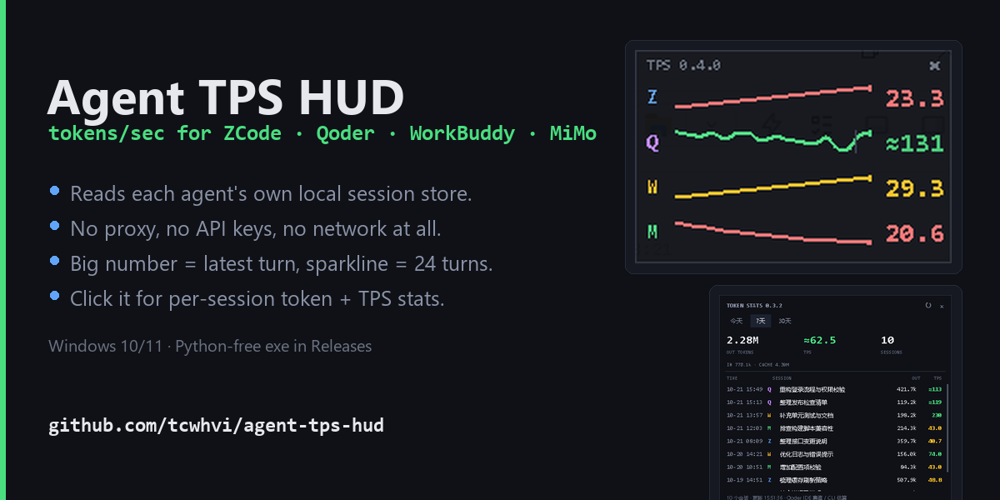
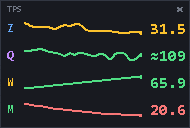
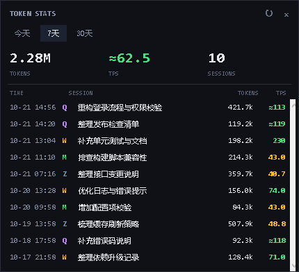

# Agent TPS HUD

[](https://github.com/tcwhvi/agent-tps-hud/releases)

一个 Windows 置顶小条，显示 ZCode / Qoder / WorkBuddy / MiMo Desktop 的输出速度（tokens/s）。

[English](README.en.md)



## 下载即用

到 [Releases](https://github.com/tcwhvi/agent-tps-hud/releases/latest) 下载 `agent-tps-hud.exe`，双击运行即可，不需要安装 Python、不需要任何配置。

它只读本机的会话数据，没有任何网络请求；关掉窗口就退出。首次运行如果 Windows SmartScreen 提示"已保护你的电脑"，是因为可执行文件没有代码签名证书（个人项目买不了），点"更多信息 → 仍要运行"即可；源码就在仓库里，也欢迎自己 `pythonw tps_overlay.py` 跑。

## 这是什么

读取本地会话数据，在屏幕角落显示每个 Agent 最近一轮的 TPS，并用曲线保留历史轮次。不接 API、不抓包、不改模型配置，也不需要 API Key。

适合：

- 比较同一个模型在不同 Agent 里的输出速度；
- 观察一轮任务里多次模型调用 + 工具调用后的整体输出速度；
- 不打开日志、不翻账单，随时看到当前速度。

悬浮窗原尺寸 190 × 128：



## 口径

**一轮** = 一次用户提问 + Agent 为回答所做的所有模型请求与工具调用，直到最终停止。

```text
TPS = Σ(输出 token + 思考 token) / Σ(模型请求耗时)
```

- 模型请求耗时包含 TTFT；
- 不含本地工具执行时间；
- 一轮里的多次模型请求全部计入，不是只看最后一次；
- 用户插话会立即结束上一轮并计入曲线；插话后的新一轮生成期间仍显示上一轮 TPS，而不是一直“生成中”；
- 大数字 = 最新完成的一轮；
- 曲线 = 最近 24 轮，跨会话保留，会话之间画一条竖分隔线；
- 工具调用本身产生的 token 计入，工具执行时间不计入。

## 支持的客户端

| 标识 | 客户端 | 本地数据源 | token 来源 |
|---|---|---|---|
| Z | ZCode | `~/.zcode/cli/db/db.sqlite`（`turn_usage` / `model_usage` / `message.tokens`） | provider output（已含 reasoning） |
| Q | Qoder | `~/.qoder-cn/projects/**/*.jsonl` + `%APPDATA%/QoderCN/SharedClientCache/cache/db/local.db` | CLI 文字估算（`≈`）；IDE 会话用 `chat_message.token_info` 真值 |
| W | WorkBuddy | `~/.workbuddy/projects/**/*.jsonl` | provider output（已含 reasoning） |
| M | MiMo Desktop / MiMo Code | `~/.local/share/mimocode/mimocode.db`（`message` / `part`） | output + reasoning 真值 |

颜色：Z 蓝色、Q 紫色、W 黄色、M 绿色。

## 从源码运行

Windows 10/11，Python 3.10+（Tkinter 随 Python 自带），无第三方依赖。不想用 Release 里的 exe 时：

```bat
start_tps_overlay.bat
```

或者：

```bat
pythonw tps_overlay.py
```

只打印一次读数（调试用）：

```bat
python tps_overlay.py --once
```

> 如果 `pythonw` 不在 PATH 里，把 `start_tps_overlay.bat` 里的命令改成你的 Python 路径。

## 操作

- 拖动任意位置移动；
- 左键短按或右键打开统计弹窗；按住拖动仍然只是移动；
- 生成期间数字保持上一轮 TPS，并缓慢闪烁，界面上不出现“生成中”这类文字；这一轮还没产出可用数字时（例如主会话刚发出第一个请求）显示 `—` 并闪烁；
- “生成中”看的是“该会话（含它派生的子代理）在 120 秒内还有写入，且这一轮还没收尾”。ZCode / MiMo 的轮次表只在轮次结束时才写入，拿它判断会永远判成空闲；WorkBuddy 看 `sessions` 表的 `status = working`，并辅以 jsonl 的进行中状态；客户端中途退出，最多 120 秒后停止闪烁；
- 拖到屏幕左/右/上/下边缘 14px 内松手，自动贴边隐藏，只留 5px 蓝色提示条；
- 鼠标移到提示条上展开，移开 0.6 秒后收起；
- 展开和收起都会核对窗口是否真的到位：移动请求被系统丢掉时自动重发，不会停在原地不动；
- 拖离边缘后不再自动隐藏；
- 点右上角 `×` 退出。

## 统计弹窗

左键短按或右键点击悬浮窗，可以查看历史会话：

- 切换今天 / 7 天 / 30 天；
- 大数字是输出 token（TPS 口径）；下方单独显示 IN / CACHE 输入与缓存 token，仅统计有 provider usage 的客户端；
- 查看该时间段的整体 TPS 和会话数；
- 按时间列出每个会话的输出 token 与 TPS；
- 会话列表支持滚轮和右侧细滚动条，到顶/到底不会继续空滚；
- 启动后会预读今天的数据，第一次点开通常直接显示；
- 弹窗开着时，“今天”数据约每 60 秒静默刷新；7 天 / 30 天在切换、重新打开或点 `↻` 时刷新；
- 读到的历史数据会缓存，重复打开直接显示；
- 会话文件按 mtime / size 做内存增量缓存，未变化就不重复解析；进程重启后首次仍需重建。



## 准确性

- **MiMo**：`output + reasoning` 和步骤耗时来自 `step-finish`，最接近真值；
- **ZCode / WorkBuddy**：直接使用 provider 返回的 output token；该字段已包含思考 token，不再额外估算，避免重复计数；
- **Qoder**：CLI / Desktop 的 transcript 不返回 usage，按 thinking + 正文文字估算，显示 `≈`，只能看趋势；IDE 会话可从 `chat_message.token_info` 读到 completion / prompt / cached token 真值，标题从 `chat_session` 取；CLI 会话名取首条用户消息的前 40 字。两个库可能同时存在，只有 IDE 库里的会话才是真值；
- 不同厂商的 tokenizer / 计费口径不同，不要把它当作官方 benchmark；同一个模型下比较更有意义。

## 隐私

只读本地会话数据库 / JSONL，提取 token 数、时间戳、文本长度等元数据；不保存、不上传 prompt 或回复内容；没有网络请求。Qoder 估算会临时读取正文/思考文本长度，会话名会截取首条用户消息的前 40 字或读取 IDE 自带标题，均不写入磁盘。SQLite 遇到写入锁时会复制临时快照读取，不改源库。

## 已知限制

- 仅支持 Windows；边缘隐藏基于主屏工作区；
- 客户端本地格式可能随版本变化；路径不存在时对应行显示 `—`；
- Qoder 的 `output_tokens` 可能始终为 0（例如 `dfmodel` 通道），只能估算；
- 悬浮窗每行只跟一个会话：ZCode 取最新的**主会话**（子代理的写入算作它还在干活），Qoder 取最新 transcript，因此同一客户端并存多个会话时（例如同时开国内版和国际版 Qoder）谁刚有动作谁占这一行，曲线仍会保留之前会话的点；
- 主会话如果只在编排子代理、自己一轮都还没收尾，就把它名下的子代理当一个任务合并计算（Σ 子代理输出 token / Σ 子代理模型耗时），避免出现空读数；主会话一旦收了自己的轮，就只算它自己的，不再混入子代理；
- 非官方项目，与各厂商无隶属关系。

## 开发

新增客户端：实现一个 monitor，返回 `Reading`（`tps`、`history`、`generating`、`note` 等字段），在 `Overlay._worker` 里注册即可。所有 SQLite 读取都使用只读 URI 模式；遇到写入锁会回退到临时快照。

测试：`python -m unittest discover -s tests -v`。

## License

MIT。如果这个工具对你有用，欢迎 Star。
